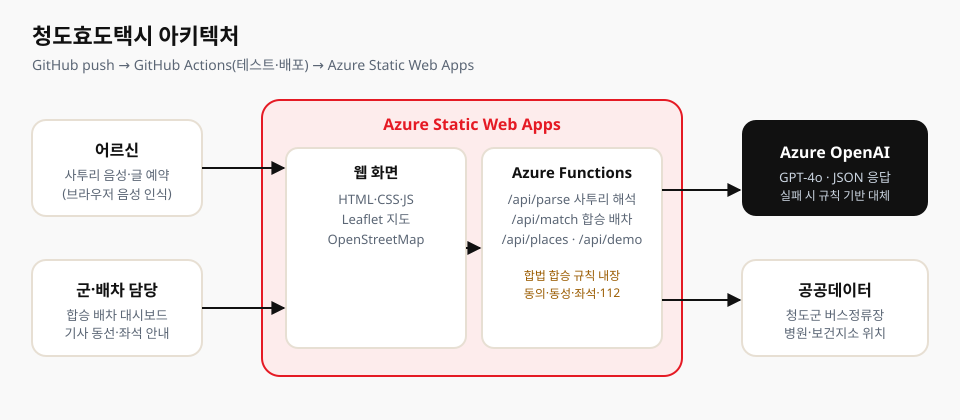

# `{{ 팀 이름 }}`팀 기획서 — 청도효도택시

## 한눈에 보기

- **제품**: 청도효도택시 — 이웃과 한 차로 모셔요
- **한 줄 요약**: 청도 어르신이 사투리로 말하면 AI가 병원 예약을 정리하고, 같은 날·같은 방향 가는 이웃을 한 차로 묶어 행복택시 운행과 군 정산 건수를 줄입니다.
- **사용자**: 병원 없는 면에 사는 어르신, 대신 신청하는 이장님·경로당 담당자, 배차·정산을 맡는 군 담당자
- **배포 주소**: {{ https://xxxx.azurestaticapps.net }} (상태 확인: `/api/health`)
- **저장소**: {{ 저장소 주소 }}

## 심사 기준별 요약

| 기준 | 무엇을 했나 | 확인 방법 |
|---|---|---|
| **기획** | 공식 통계로 문제를 정의(의료취약지, 65세 이상 45.1%, 병원 없는 4개 면)하고, 이미 있는 자원(택시의 빈자리, 정원 대비 3.5%만 신청된 관광택시)을 잇는 개선안을 설계 | 아래 '문제'·'지금 → 개선' 표 |
| **코드 구현** | Azure OpenAI로 사투리 예약 해석(실패 시 규칙 기반 자동 대체), 합승 배차 알고리즘(시간창·우회 거리·일행·성별 규칙), Azure Static Web Apps + Functions, GitHub Actions 자동 배포, Bicep 인프라 코드, 자동 테스트 9개 | `api/src/lib/*.js`, `tests/core.test.js`, `.github/workflows`, `infra/main.bicep` |
| **사용자 경험** | 70세 이상 시니어 컬러 기준(흰 바탕·짙은 검정 글자·딥블루 버튼, 글자 대비 4.5:1 이상), 어둡게 모드·글자 크게, 한 화면에 한 질문, 말로 예약, 실제 버스정류장 이름으로 타는 곳 안내, 탑승권 좌석 지도, 이장님·경로당 대리 신청, 가족에게 알리기 | 배포 주소 첫 화면, 아래 '사용자 경험 설계 근거' |

## 참가 동기

청도는 국립중앙의료원이 지정한 의료취약지이고, 각남·각북·운문·매전 네 개 면에는 민간 병원이 하나도 없습니다. 그런데 병원 가는 택시는 어르신 한 분만 태우고 나머지 자리를 비운 채 달립니다. 같은 날 같은 병원에 가는 이웃이 있어도 각자 따로 부릅니다. "이게 왜 안 되지?"라는 질문에서 출발해, 이미 있는 택시의 빈자리라는 놀고 있는 자원으로 어르신의 이동권을 넓히고자 참가했습니다.

## 문제 (숫자로 본 청도)

- 청도군 65세 이상 비율 45.1%, 평균 연령 59.1세 (행정안전부 주민등록, 2026.9)
- 청도군은 국립중앙의료원 '2025 의료취약지 모니터링'에 포함된 의료취약지 (뉴스1, 2026.8)
- 각남·각북·운문·매전 4개 면에 민간 의료기관 없음, 보건지소 전문의 진료는 주 1회 이상 (경북매일, 2026.7)
- 병원 없는 4개 면의 평균 연령 62.6~64.1세
- 70세 이상 42명 중 8명만 택시 호출 앱을 쓸 수 있음 (헤럴드경제, 2026.8, 서울 대형병원 앞 조사)
- 청도군은 대중교통 취약지역에 행복택시를 운영하지만, 택시는 대부분 한 분씩 따로 움직임

## 지금 행복택시 → 청도효도택시 개선안

| 지금 | 청도효도택시 |
|---|---|
| 읍·면사무소나 이장님을 거쳐 이용자 등록 | 이장님·경로당이 앱에서 등록 요청과 예약을 함께, 어르신 본인도 직접 |
| 마을 전담 기사님께 개인 전화로 예약, 기록이 남지 않음 | 사투리 그대로 AI가 접수, 모든 예약이 기록되고 통합 배차 |
| 같은 날 같은 곳에 가도 한 분씩 따로 운행, 운행마다 군이 차액 정산 | 면 경계를 넘어 같은 방향끼리 합승 → 샘플 12건 기준 운행·정산 12건 → 6건 |
| 운행 구간이 정해져 있어 병원까지 바로 가기 어려움 | (제안) 같은 방향 어르신이 모이면 병원·대구 협약병원까지 구간 확대 |
| 관광택시는 외지 관광객 전용, 올해 정원 999명에 신청 35명 (청도군 통합예약시스템, 2026.10.24) | (제안) 평일 관광택시를 어르신 이동 보조 차량으로 활용 |

※ 현행 행복택시의 세부 기준(대상 마을 수, 운행 구간, 본인 부담금)은 청도군 확인 중입니다. 확인된 사실은 '청도군이 대중교통 취약지역에 행복택시를 운영한다'는 것입니다(경북매일, 2021).

## 주요 기능 및 특징, 기대 효과

**주요 기능**
1. **사투리 그대로 예약** — "내일 아침 열 시까지 대구 효성병원 가야 되는데예"라고 말하면 Azure OpenAI가 타는 곳·가는 곳·날짜(요일 포함)·도착 시각·용무를 정리합니다. 빠진 정보는 사투리로 되묻습니다.
2. **AI 통합 배차** — 같은 날·같은 목적지·비슷한 시간(60분 이내)의 예약을 면 경계 없이 묶고, 목적지에서 먼 분부터 태우는 동선과 탑승 시각을 도착 시각에서 거꾸로 계산합니다. 같은 곳에서 타는 분은 같은 시각에 모십니다.
3. **합법 합승 규칙 내장** — 택시발전법 시행규칙(2022.6.15 시행)의 플랫폼 중개 합승 기준을 배차 규칙으로 반영: 사전 동의한 분만 합승, 모르는 분과는 같은 성별끼리, 함께 신청한 이웃(일행)은 한 차, 함께 타는 분의 탑승 위치·시각과 내 좌석을 미리 안내, 긴급신고(112) 버튼.
4. **이장님·경로당 대리 신청 + 개인 신청** — 명단에서 여러 어르신을 골라 한 번에 신청하거나 어르신이 직접 신청. 타는 곳은 청도군 버스정류장 현황(공공데이터, 2025.8.28)의 실제 정류장 이름으로 안내(예: 대천공용버스터미널). 등록 전 어르신은 예약과 함께 행정복지센터로 등록 요청이 접수됩니다. 청도군은 모든 경로당에 비상벨을 설치했고 노인일자리 '경로당 깔끄미' 참여자가 있어 경로당이 거점이 되기 자연스럽습니다.
5. **어르신 우선 화면** — 한 화면에 한 질문, 말로 예약(말이 끝나면 자동 정리), 자주 가는 곳 목록과 예상 소요 시간, 확인 내용을 소리로 읽기, 글자 크게, 엄지 영역 하단 버튼, 탑승권 모양 완료 화면과 좌석 지도, 배차 상태 타임라인(탑승 1시간 전 기사님 확인 전화), 가족에게 알리기. 우버 시니어 계정(큰 글씨·적은 버튼·가족 대리 예약)과 카카오T 전화 호출을 참고했습니다.
6. **배차 담당 화면** — '지금 방식'과 '청도효도택시'의 운행·군 정산 건수 비교, 지도 위 차량별 동선, 주행거리 절감·좌석 채움률.

**특징**
- 새 제도가 아니라 이미 있는 자원(택시의 빈자리)을 쓰는 구조
- AI 호출이 실패해도 규칙 기반 해석으로 자동 전환되어 서비스가 멈추지 않음
- 지도 라이브러리를 앱에 내장해 외부 CDN이 막혀도 동작

**기대 효과** (샘플 예약 12건 시뮬레이션, 지금 차량 그대로)
- 운행·군 정산 12건 → 6건
- 주행거리 45% 절감 (실제 정류장·병원 좌표 기준)
- 같은 예산으로 더 많은 어르신 이동

## 사용자 경험 설계 근거

청도 65세 이상 인구는 45.1%이고, 실제 이용자는 70~80대입니다. 그래서 '보기 좋은 화면'보다 '노안·황화 현상이 있어도 틀리지 않는 화면'을 기준으로 삼았습니다.

| 원칙 | 적용 | 수치·근거 |
|---|---|---|
| 글자와 바탕의 대비 | 흰 바탕 + #111111 글자, 보조 글자도 회색 대신 #333333 | 본문 18.9:1, 보조 12.6:1 (기준 4.5:1) |
| 누를 곳은 한 가지 색 | 다음·예약·마이크만 딥블루 #0052CC + 흰 글씨, 나머지 버튼은 흰 바탕 + 2px 테두리 + 검은 글씨 | 주 버튼 6.8:1 |
| 파랑·초록을 나란히 두지 않음 | 황화 현상으로 뭉쳐 보이므로 '내 자리'는 파랑, '함께 타는 분'은 딥오렌지 #8A4500 | 7.2:1 |
| 긍정·위험 색 분리 | 완료·확인 = 딥그린 #00875A, 긴급신고 112 = 딥레드 #DE350B | – |
| 빛 번짐 대응 | '어둡게' 모드: 검은 바탕 + 노란 버튼·흰 글자 | 주 버튼 13.5:1 |
| 글자 크기 | 본문 18px(글자 크게 22px), 질문 30px, 주요 버튼 64px 이상 높이 | – |
| 손이 떨려도 누르기 쉬움 | 하단 고정 큰 버튼, 버튼 사이 간격 10px 이상 | – |
| 글 대신 말 | 사투리로 말하면 AI가 정리, 확인 내용을 소리로 다시 읽어 줌 | – |
| 아는 이름으로 안내 | 타는 곳을 좌표가 아닌 실제 버스정류장 이름으로, 날짜는 항상 요일과 함께("내일, 10월 25일 일요일") | 청도군 버스정류장 현황 |
| 혼자가 아니어도 됨 | 이장님·경로당이 여러 분을 한 번에 신청, 가족에게 예약 내용 보내기 | – |

## 제품 아키텍처 (이미지)

- 화면: Azure Static Web Apps (HTML·CSS·JS, Leaflet 지도)
- API: Azure Functions (Node.js 20) — `/api/parse` 사투리 해석, `/api/match` 합승 배차, `/api/places`, `/api/demo`, `/api/health`
- AI: Azure OpenAI (JSON 응답), 실패 시 규칙 기반 대체
- 배포: GitHub Actions(테스트 → 배포), Bicep 인프라 코드, 원클릭 배포 스크립트

## 제품 소개 슬라이드 (선택)

이번 대회는 발표 시간이 없어 슬라이드를 따로 만들지 않았습니다.

## 제품 소개 동영상 (선택)

{{ 영상 링크 }}
